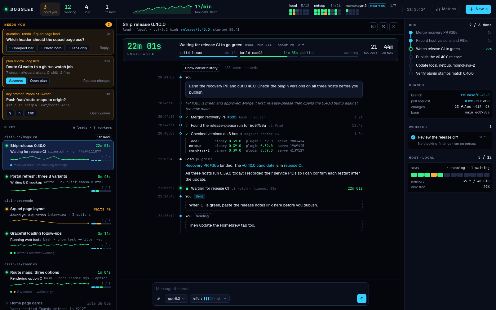
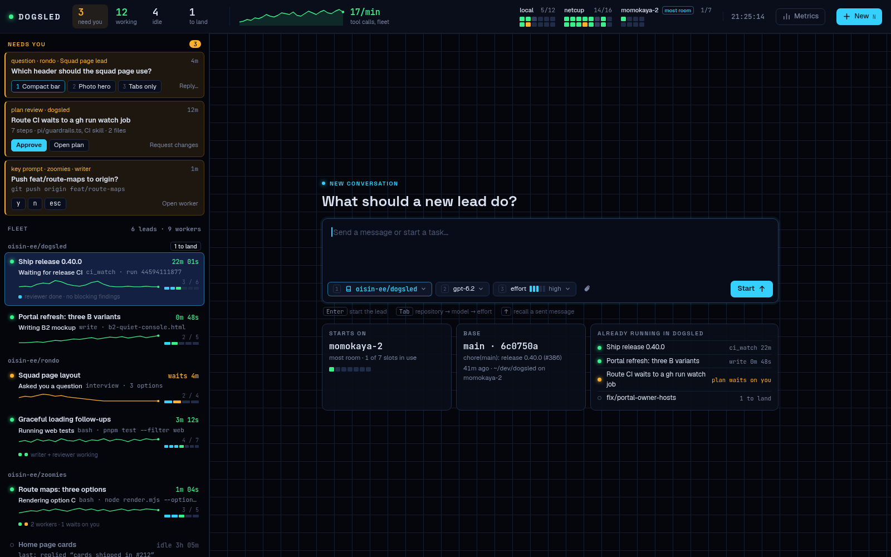
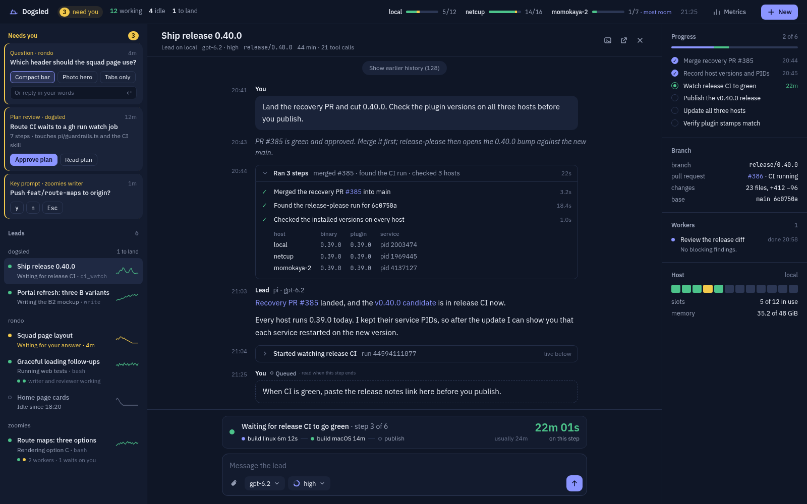
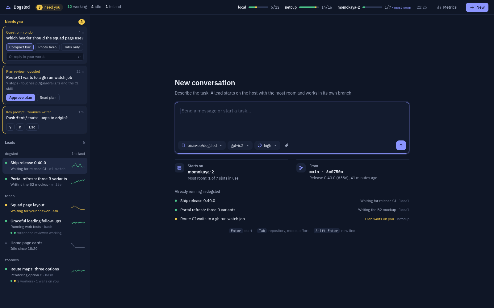
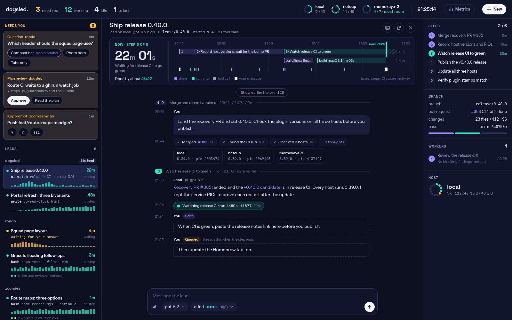
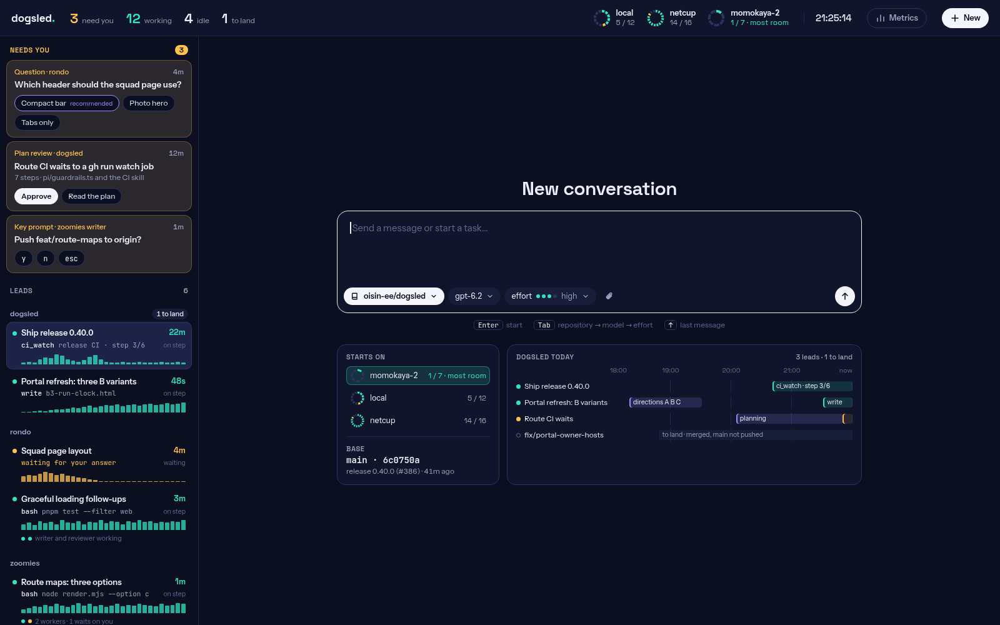

# Portal refresh: three variants of direction B

Status: proposal for owner choice. Nothing in `web/` changes until the owner picks a variant.

The owner chose direction B, "Live fleet", from PR #390 and dropped A and C. The original B is `.impeccable/mocks/refresh/b-live-fleet.html` on the branch `design/portal-refresh-options`. This directory has three variants of B. Each variant takes a different thesis.

Each variant is one static HTML file with two screens at 1600 × 1000:

- the lead conversation with the sidebar (default), and
- New conversation (`?screen=new`).

All three show the same fleet: the repositories dogsled, rondo and zoomies; the "Ship release 0.40.0" lead in dogsled; three items that need the owner; and the hosts local, netcup and momokaya-2.

## What every variant keeps from B

- A dark navy console that is dense and shows the fleet at work.
- A Now panel with the time on the current step and the CI stages.
- For each lead in the sidebar: the current tool call and an activity graph.
- Capacity for each host in the top bar.
- Needs you cards at the top of the sidebar.
- A right column with the run steps, the branch, the workers and the host.
- A New screen that shows the host the lead starts on, the base commit and the work that already runs in the repository.

## What every variant shows from #392

- **New composer.** The composer is in the centre and has focus. The title is "New conversation" and the placeholder is "Send a message or start a task…". The control row has the repository, model and effort controls in that order, which is also the Tab order after the message. Effort is a separate control. Enter starts the lead, so the "Launch ⌘↵" button of B is gone.
- **Delivery states.** An owner message that the transcript has not recorded yet stays in the conversation with its state: Sending…, Sent or Queued. B1 shows Sent and Sending…, B2 shows Queued, and B3 shows Sent and Queued. The pending message has a dashed outline until the transcript records it.
- **Show earlier history.** The conversation opens with its newest records and starts with a "Show earlier history" control and the count of older records.

## What every variant fixes in B

1. **Time on step was ambiguous.** B showed "22:01" in large numerals next to a "21:25:14" clock, so it read as a clock time. All variants write durations as "22m 01s" or "22m".
2. **Needs you cards did not let you answer.** Each card now has its answer in place: the question options (with the recommended option marked), Approve and Open plan for a plan review, and the keys for a key prompt (Product Principle 3).
3. **Tool calls were still machine lines.** B showed `workflow=release-please sha=6c0750a`. The variants say what happened in words ("Found the release-please run for 6c0750a"). The tool name and arguments are muted or folded. Host checks show as a small table or cards, never JSON.
4. **The Now panel did not say when the step ends.** Each variant uses the usual run time to show the time left or the expected end ("about 2m left", "Done by about 21:27").
5. **The host with the most room was not marked.** The top bar marks momokaya-2 as "most room", and the New screen says that the lead starts there.
6. **The New screen did not show branches to land.** The "already running" list on New includes a branch that is still to land, so the owner sees the debt before starting more work.

## B1 · Fleet wall (the fleet leads)

**Thesis.** The owner opens the portal to see the fleet first. The sidebar becomes a wall of instruments. Each lead row shows its title, what it does now in words, the tool call in mono, the time on the current step, a full-width activity line, and a step bar. The top bar adds a fleet pulse (tool calls per minute for the whole fleet) and a two-row slot grid for each host. The conversation is a tight terminal-like timeline under a compact Now panel with a progress bar for each CI stage.

- **Darkness.** Darkest of the three: near-black navy `#04060c`, panel `#090e1a`.
- **Density.** Highest: 12.5px interface text, 13px messages, seconds in the time gutter, a 376px sidebar.
- **Colour.** Cyan `#36d0ff` for selection and primary actions, phosphor green `#39f08a` for running (with a glow), amber `#ffb02e` for waiting.
- **Type.** Geist for the interface, Space Grotesk for brand and labels, JetBrains Mono for every number, time and machine line.
- **New screen.** A blueprint grid. The composer has numbered Tab stops on the repository (1), model (2) and effort (3) controls, and a key legend below. Three readout cards show the host, the base commit and what already runs in dogsled.

**Breaks from DESIGN.md.**

- Palette: navy-black ground instead of console black and graphite. Cyan replaces signal indigo. The waiting colour is amber `#ffb02e`, not waiting yellow `#f2c94c`.
- The Flat Console Rule: the running green, the brand dot and the time on step glow (box and text shadows). The New screen has a decorative grid background.
- The Mono Means Machine Rule: JetBrains Mono also sets counts, durations, host counts and the time gutter.
- Fonts: Geist and Space Grotesk replace Inter.
- Layout: a 60px top bar (not 44px) and a 376px sidebar (not 280px). The 300px todos column becomes a 296px Run column with steps, branch, workers and host.
- Message timeline: a 58px gutter with seconds. Each tool record has its own summary row instead of one folded row. The Now panel sits at the top of the conversation, not between the history and the composer.
- Waiting row: Needs you items are cards with answer controls. A waiting lead also stays in its repository group with a "waits 4m" state.
- Helper text: a key legend sits under the New composer.

## B2 · Quiet console (the conversation leads)

**Thesis.** The owner comes back to read what the lead said and to reply. The conversation is the largest and calmest part of the screen. Lead replies are 15px prose. Tool work folds into one row ("Ran 3 steps · merged #385 · found the CI run · checked 3 hosts") that opens to a short list and a table. The Now panel moves to the live edge, docked between the history and the composer. A Queued message then sits directly above the panel that explains why it is queued. The fleet stays visible but quiet: thin host meters, small activity lines, and the current tool in words with the tool name in muted mono.

- **Darkness.** Lightest of the three: slate navy `#0f1626`, panel `#131b2e`, raised `#1a2339`.
- **Density.** Medium: 13px interface, 15px messages at a 640px measure, minute timestamps.
- **Colour.** The closest to DESIGN.md: a lighter signal indigo `#8b95ff` for selection, primary actions and done steps; green `#4cc38a` for running; yellow `#f2c94c` for waiting. No glows and no gradients.
- **Type.** IBM Plex Sans for the interface and prose, JetBrains Mono only for branches, commands and versions.
- **New screen.** A plain field. The composer has the indigo focus ring, and the effort control uses the shipped effort ring. Under it, two facts (the host and the base commit) and the list of leads that already run in dogsled, with their state and host.

**Breaks from DESIGN.md.**

- Palette: slate navy instead of console black and graphite, and a lighter indigo (`#8b95ff` instead of `#5e6ad2`).
- Fonts: IBM Plex Sans replaces Inter.
- Type sizes: messages are 15px, not the 13px body size. The conversation title is 18px, not 14px.
- Focus: the New composer uses a 3px indigo ring instead of the 2px outline at a 2px offset.
- Layout: a 48px top bar (not 44px), a 292px sidebar (not 280px), and a 288px right column with progress, branch, workers and host instead of the todos column.
- Waiting row: Needs you items are raised cards with answer controls and a reply field. A waiting lead stays in its repository group.
- Helper text: one sentence under the New title and a key legend under the composer.

## B3 · Run clock (time leads)

**Thesis.** The question the owner asks most is "how long, and when will it finish?". So every part of the screen uses one clock. The Now panel becomes a timeline of the run from 20:40 to 21:30. It has three lanes: the steps, the CI stages and the activity (tool calls and the owner's messages as ticks). A cursor marks now, and a striped segment shows the expected end. The large "22m 01s" and "Done by about 21:27" sit beside it. The transcript is grouped by step, with the step number, name and duration as a heading. Tool calls are one row of chips. In the sidebar each lead has an activity histogram. On New, the repository's day shows on the same kind of timeline, so the owner sees what ran, what runs, what waits and what is still to land.

- **Darkness.** Middle: violet-navy dusk `#0c0f1f`, panel `#11152b`.
- **Density.** Medium-high: a timeline panel across the conversation, 13px interface, 14px messages.
- **Colour.** White `#f4f5ff` for primary actions and the selected repository, violet `#9d8cff` for done steps and links, teal `#2ee6c5` for running, amber `#ffc34d` for waiting. Host capacity shows as segmented rings.
- **Type.** Instrument Sans for the interface, Space Grotesk for the brand, titles and all large numerals, JetBrains Mono for tool calls.
- **New screen.** A centred title and composer with the repository control filled white. Below it, a host chooser with a ring for each host (momokaya-2 is selected because it has the most room), the base commit, and "dogsled today" as lanes on a time axis.

**Breaks from DESIGN.md.**

- Palette: violet-navy instead of console black and graphite. The primary action is white, not indigo. Done is violet. Running is teal, not running green. Waiting is amber `#ffc34d`.
- The One Meaning Rule: white marks the primary action and the selected repository; violet marks done and links.
- The Flat Console Rule: the expected end of the step is a striped (repeating gradient) segment. The running cursor has a soft halo.
- Fonts: Instrument Sans and Space Grotesk replace Inter. Numerals go up to 40px, above the 16px headline.
- Shapes: buttons, chips and pickers are pills (13–18px radius), outside the 4–10px scale. Owner messages have one smaller corner.
- Layout: a 58px top bar, a 318px sidebar, and a 278px right column with steps, branch, workers and host instead of the todos column.
- Message timeline: new step headings group the records. Tool records show as chips. The Now panel is at the top of the conversation.
- Waiting row: Needs you items are cards with answer controls. A waiting lead stays in its repository group.
- Helper text: a key legend under the New composer, and a legend under the run timeline.

## The three side by side

| | B1 Fleet wall | B2 Quiet console | B3 Run clock |
| --- | --- | --- | --- |
| What leads | The fleet | The conversation | Time and the run |
| Ground | `#04060c` near-black | `#0f1626` slate | `#0c0f1f` violet dusk |
| Primary | Cyan | Indigo | White |
| Interface type | Geist 12.5px | IBM Plex Sans 13px | Instrument Sans 13px |
| Messages | 13px | 15px | 14px |
| Now panel | Top, compact, CI bars | Docked at the live edge | Top, a timeline of the run |
| Tool work | One summary row each | Folded into one row | Chips, grouped by step |
| Lead activity | Full-width line and step bar | 46px line | Histogram |
| Host capacity | Two-row slot grid and fleet pulse | Thin meters | Segmented rings |
| Effort control | Bars | Ring (as shipped) | Dots |
| Glow | Yes | No | Halo on the now cursor only |

## Files

| File | What it is |
| --- | --- |
| `b1-fleet-wall.html` | Variant B1, both screens |
| `b2-quiet-console.html` | Variant B2, both screens |
| `b3-run-clock.html` | Variant B3, both screens |
| `*-conversation.png`, `*-new.png` | 1600 × 1000 captures; provenance in the `.png.json` beside each |
| `review.json` | The decision manifest in the format of the earlier mock reviews |
| `capture.sh` | Captures the PNGs again with `mise run agent:browser` |
| `fonts/` | Self-hosted OFL 1.1 faces from `.impeccable/mocks/refresh/fonts/` (PR #390), with their licence texts |

To capture all six screenshots again, run `.impeccable/mocks/refresh-b/capture.sh`. To capture one variant, give `file:prefix`, for example `capture.sh b2-quiet-console:b2`.
