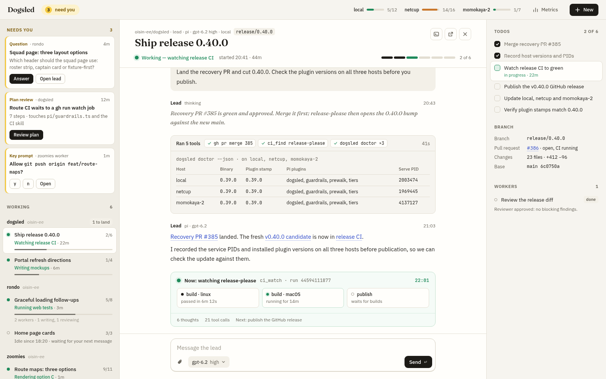
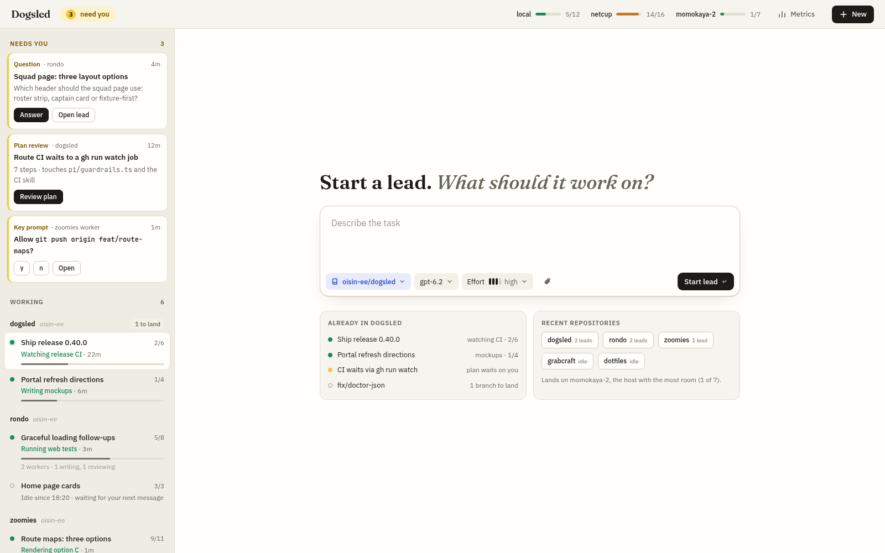
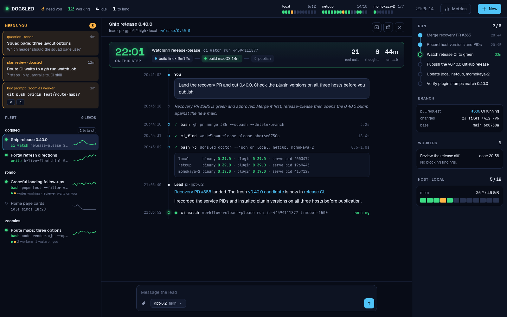
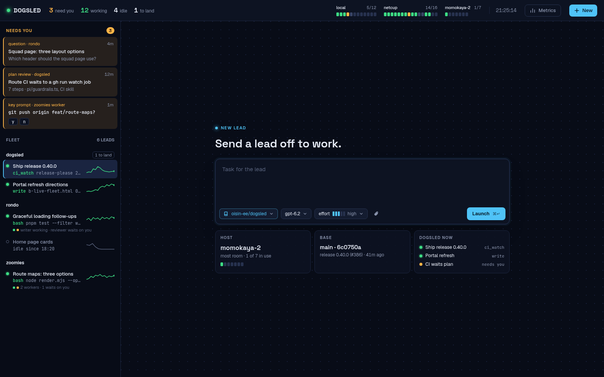
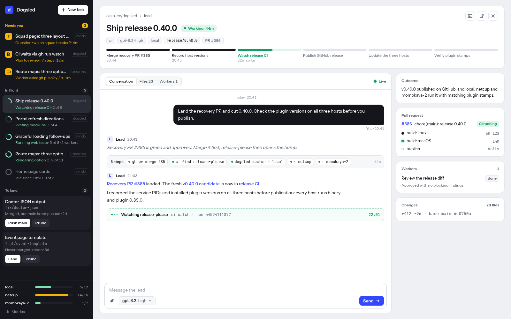
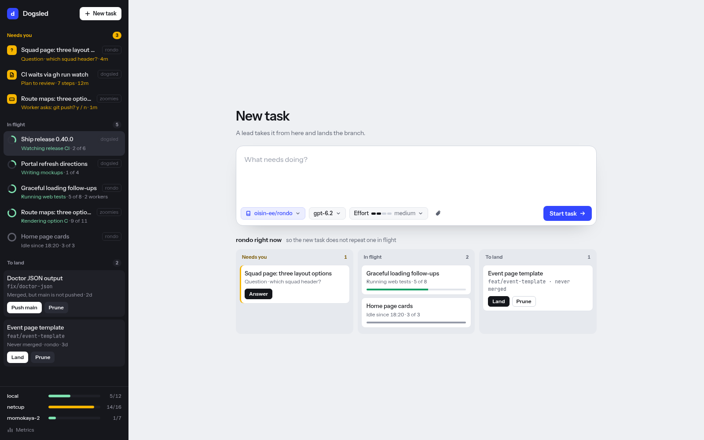

# Portal refresh: three directions

Status: proposal for owner choice. Nothing in `web/` changes until the owner picks a direction.

Each direction is one static HTML file with two screens at 1600 × 1000:

- the agent conversation with the sidebar (default), and
- New conversation (`?screen=new`): the composer is centred, and the repository, model and effort pickers sit in the composer control row.

All three use the same fleet: repositories dogsled, rondo and zoomies; the "Ship release 0.40.0" lead in dogsled; three items that need the owner (a question, a plan review and a worker key prompt); and the hosts local, netcup and momokaya-2.

## Why the portal feels stale and pointless today

From the current screenshots (`/tmp/dsimg/design/*.png`, `/tmp/dsimg/ref.png`):

1. **New conversation is an empty dark field.** The repository picker sits in the top-right corner, the composer sits at the bottom, and nothing between them says what will happen or what already runs in that repository.
2. **The sidebar lists slugs, not work.** Rows such as `rondo-there-was-lead` show a green dot and nothing else. You cannot see which agent is doing what, how far it is, or whether it is stuck.
3. **The conversation shows raw machine output.** Large JSON tool outputs fill the screen. The one useful sentence from the lead is lost between them, and the live state is a small grey line above the composer.
4. **Everything has the same weight.** One near-black tone, one grey text style and no hierarchy between the task, the conversation and the progress.

The three directions fix the same four problems in different ways.

## A · Daylight briefing (light)

**Thesis.** The portal is a briefing that you read when you come back. It should feel like a well-set document on paper, not a terminal. The task title is the headline, the lead's replies are readable prose, and machine work folds into short, structured "Ran 5 tools" blocks that show results (a host version table), not JSON. The live state is a clear "Now" card at the live edge with the CI jobs as named steps. The Needs you section becomes cards with the question text and the action buttons on the card.

- **Palette.** Warm paper `#f6f4ef`, sidebar `#efece4`, sheet `#fffefb`, ink `#1d1b17`, muted `#69655b`. Running green `#1e8a5a`, waiting yellow `#f4c93f` with amber text `#7a5600`, link blue `#2b47c9`. Black ink is the primary action.
- **Type.** Fraunces (titles and thoughts in italic), IBM Plex Sans 13.5–15px for the interface and prose, JetBrains Mono for commands and versions.
- **Density.** Medium. More air than today: two-line sidebar rows, 15px prose at a 700px measure.
- **Beyond colour.** Each sidebar row shows the task title, its live activity ("Watching release CI · 22m") and a todo progress bar. The conversation header shows a six-segment todo bar. Tool output is summarised into tables. A "Needs you" pill sits in the top bar. New conversation has a headline, a large composer with the pickers in its control row, and two context panels: what already runs in the chosen repository, and recent repositories with the host the lead will land on.
- **Breaks in DESIGN.md.** Light theme, a serif face, and one soft shadow under the New composer.

## B · Live fleet (dark, but alive)

**Thesis.** Keep the dark console, but make it an instrument panel that visibly moves. The owner should see in one glance that the fleet is working: a fleet strip with totals and a slot grid per host, a sparkline of recent activity on each lead row, and the current tool call in mono under each title. In the conversation, a "Now" panel at the top shows the elapsed time on the current step in large numerals, the CI pipeline stages and live counters. The history below is a tight timeline: one mono line per tool call with a status and a duration.

- **Palette.** Night navy `#080c17`, panel `#0d1322`, raised `#141c30`, line `#1c2640`, text `#e7ecf7`, muted `#8b95ae`. Cyan `#4fc3f7` for selection and primary actions, green `#3ddc84` for running (with a soft glow), amber `#ffb547` for waiting.
- **Type.** Geist 13px for the interface, Space Grotesk for numbers and headings, JetBrains Mono for tool lines and live activity.
- **Density.** High. Seconds-precision timestamps, one-line tool calls, the stepper and host load always visible.
- **Beyond colour.** The top bar becomes a fleet strip (need you / working / idle / to land, plus a slot grid per host with one cell per agent). Sidebar rows show an activity sparkline and the live tool call. The conversation leads with the Now panel. The right column becomes a "Run" stepper with the time of each step, the branch, the workers and the host load. New conversation is a launch console on a dot grid: the composer with the pickers, then a readout of the target host, the base commit and what already runs in the repository.
- **Breaks in DESIGN.md.** Cyan replaces indigo, and the running green has a glow. It stays predominantly dark.

## C · Task desk (two-tone, task first)

**Thesis.** Make the task, not the agent, the unit of the screen. An ink rail on the left sorts all work by what it needs: Needs you, In flight and To land, with Land, Push main and Prune buttons on each branch to land (Product Principle 5). The main area is a light desk with cards. The task card shows the title, the status and a horizontal stepper of the todos. Below it, the conversation and an Outcome column (the deliverable, the pull request with its CI jobs, workers and changes) sit side by side. The conversation reads like a chat: owner messages in ink bubbles, tool calls as one chip row, and a live "typing" row at the live edge.

- **Palette.** Ink rail `#16171c` with text `#f1f1f4`; desk `#eef0f3`; white cards; text `#14161b`, muted `#5d6371`. Ultramarine `#3347ff` for the primary action and links, green `#0f9d62` for running, yellow `#f6b500` for waiting.
- **Type.** Instrument Sans for everything (26px task titles, 13.5–14px body), JetBrains Mono for branches and commands.
- **Density.** Medium-high: card padding, but the progress, the PR and the CI jobs are all on the first screen.
- **Beyond colour.** The top bar is gone. New task sits at the top of the rail and the host meters at its foot. The sidebar groups by state, not by repository; each row shows a progress ring and a repository tag. "To land" becomes a lane of decisions with buttons. The todos become a stepper across the task card. New task shows a three-lane board of the chosen repository (Needs you, In flight, To land) below the composer, so the owner does not start a duplicate.
- **Breaks in DESIGN.md.** No top bar, a light main area, cards with a soft shadow on the New composer, and branches to land listed in the rail (the owner's 2026-11-02 rule kept them out of the inbox; here they are a separate lane, not inbox items).

## Shared changes in all three

- New conversation centres the composer and puts the repository, model and effort pickers in the composer control row.
- Sidebar rows show the task title, the live activity and the progress instead of the agent slug.
- The live state moves from a grey line above the composer to a visible block at the live edge or top of the conversation.
- Tool output is summarised or folded; raw JSON is never the main content.

## Files

| File | What it is |
| --- | --- |
| `a-briefing.html` | Direction A, both screens |
| `b-live-fleet.html` | Direction B, both screens |
| `c-task-desk.html` | Direction C, both screens |
| `*-conversation.png`, `*-new.png` | 1600 × 1000 captures; provenance in the `.png.json` beside each |
| `review.json` | The decision manifest in the format of the earlier mock reviews |
| `capture.sh` | Recaptures the PNGs with `mise run agent:browser` |
| `fonts/` | Self-hosted OFL 1.1 faces with their licence texts |

Recapture: `.impeccable/mocks/refresh/capture.sh a-briefing:a b-live-fleet:b c-task-desk:c`
